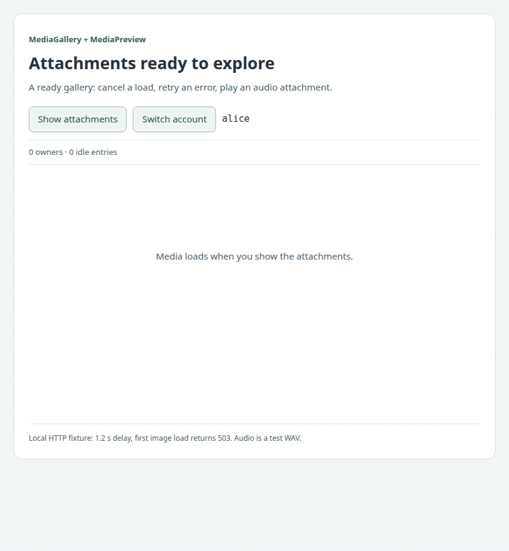
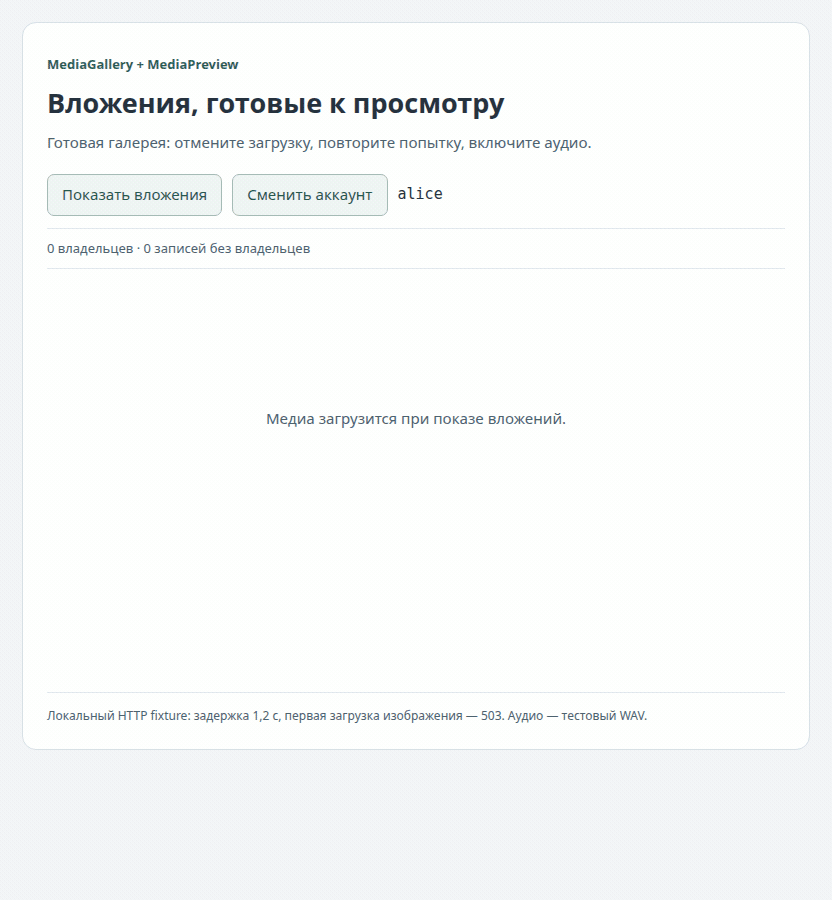

# browser-media-cache-react

<details name="readme-language">
<summary><picture><source media="(prefers-color-scheme: dark)" srcset="assets/lang-en-dark.svg"></picture></summary>

**An attachment gallery with loading, retry, cancellation and native media controls already connected.** Supply your media keys and one account-scoped cache. Images, short audio and video attachments reuse downloads across views; you can still build custom UI with the lower-level components.

**0.1.0 · React 18.3+/19 · TypeScript · MIT** · [Application guide](docs/0.1.0/application.en.md) · [API reference](docs/0.1.0/reference.en.md)

<picture><source media="(prefers-reduced-motion: reduce)" srcset="docs/0.1.0/visuals/gallery.en.png"></picture>

[Static frame](docs/0.1.0/visuals/gallery.en.png) · [Code and interaction walkthrough](docs/0.1.0/application.en.md#try-the-gallery). The recording uses a local HTTP fixture with a deliberate first-load failure and a test audio file.

## Get started in your React application

Add these dependencies to the existing `package.json` (React 19 is also supported):

```json
{
  "dependencies": {
    "@59alex/browser-media-cache": "0.1.0",
    "@59alex/browser-media-cache-react": "0.1.0",
    "react": "^18.3.1",
    "react-dom": "^18.3.1"
  }
}
```

The two @59alex packages are not published to npm yet. [Local artifact setup](docs/0.1.0/en.md#local-installation) lets you evaluate these coordinates now.

```tsx
import { createHttpMediaCache } from '@59alex/browser-media-cache';
import { MediaCacheProvider, MediaGallery } from '@59alex/browser-media-cache-react';

// EN: Create once in the browser application's composition root.
// RU: Создайте один раз в точке сборки браузерного приложения.
const cache = createHttpMediaCache({
  url: ({ key }) => `/api/media/${encodeURIComponent(key)}`,
});

export function Attachments({ accountId }: { accountId: string }) {
  return <MediaCacheProvider cache={cache} namespace={accountId}>
    <MediaGallery items={[
      { id: 'photo', mediaKey: 'photo:42:v3', alt: 'Project sketch' },
      { id: 'voice', mediaKey: 'voice:19:v1', kind: 'audio', alt: 'Voice attachment' },
    ]} />
  </MediaCacheProvider>;
}
```

The backend authenticates and authorizes `/api/media/:key`. The default profile limits each HTTP response to 8 MiB and the entire load to 30 seconds. The [full source example](examples/AttachmentGallery.tsx) includes cache creation, account URLs, business metadata and logout cleanup; the [guide](docs/0.1.0/application.en.md) walks through each part.

## Start with one preview

```tsx
<MediaPreview mediaKey="photo:42:v3" alt="Project sketch" language="en" />
```

Inside the same provider, this shows loading, an error with retry, and a cancel/resume control. `kind="audio"` or `kind="video"` uses browser controls without autoplay. [Preview states and codec limits](docs/0.1.0/application.en.md#one-preview-and-its-states) · [Complete gallery source](examples/AttachmentGallery.tsx).

## Show your attachment collection

```tsx
<MediaGallery items={attachments} language="en" />
```

Give each item a stable `id`, `mediaKey`, `alt`, optional `title` and `kind`. Matching media keys share a load; cards own cancellation independently. Layout adapts to the available width. [Data and sharing](docs/0.1.0/application.en.md#your-data-and-shared-downloads) · [Full source](examples/AttachmentGallery.tsx).

## Keep your own design

```tsx
<MediaBoundary mediaKey="notes:v2">
  {resource => <a href={resource.url} download>Download notes</a>}
</MediaBoundary>
```

`CachedImage`, `MediaBoundary` and `useCachedMedia` remain available with custom fallbacks. [Every primitive in motion](docs/0.1.0/visuals.en.md) · [Complete custom UI](examples/Gallery.tsx).

These are complete-Blob previews, not streaming players for large files. Native codec support belongs to the browser. A decoding failure offers **Retry display**; fetching corrected content requires a new versioned key or explicit application invalidation. Providers never dispose caller-owned caches or clear account persistence automatically. [Account lifecycle and errors](docs/0.1.0/application.en.md#account-lifetime) · [All documentation](docs/index.md) · [MIT](LICENSE).

</details>

<details name="readme-language" open>
<summary><picture><source media="(prefers-color-scheme: dark)" srcset="assets/lang-ru-dark.svg"></picture></summary>

**Галерея вложений с готовыми загрузкой, повтором, отменой и нативным плеером.** Передайте ключи медиа и один кэш с областью аккаунта. Изображения, короткие аудио- и видеовложения используют общие загрузки в разных представлениях; для собственного UI остаются низкоуровневые компоненты.

**0.1.0 · React 18.3+/19 · TypeScript · MIT** · [Руководство для приложения](docs/0.1.0/application.ru.md) · [Справочник API](docs/0.1.0/reference.ru.md)

<picture><source media="(prefers-reduced-motion: reduce)" srcset="docs/0.1.0/visuals/gallery.ru.png"></picture>

[Статичный кадр](docs/0.1.0/visuals/gallery.ru.png) · [Код и разбор действий](docs/0.1.0/application.ru.md#попробовать-галерею). Запись использует локальный HTTP-fixture с намеренной первой ошибкой загрузки и тестовым аудио.

## Подключение к React-приложению

Добавьте зависимости в существующий `package.json` (React 19 также поддерживается):

```json
{
  "dependencies": {
    "@59alex/browser-media-cache": "0.1.0",
    "@59alex/browser-media-cache-react": "0.1.0",
    "react": "^18.3.1",
    "react-dom": "^18.3.1"
  }
}
```

Два пакета @59alex пока не опубликованы в npm. Для проверки этих координат доступна [установка локальных артефактов](docs/0.1.0/ru.md#локальная-установка).

```tsx
import { createHttpMediaCache } from '@59alex/browser-media-cache';
import { MediaCacheProvider, MediaGallery } from '@59alex/browser-media-cache-react';

// EN: Create once in the browser application's composition root.
// RU: Создайте один раз в точке сборки браузерного приложения.
const cache = createHttpMediaCache({
  url: ({ key }) => `/api/media/${encodeURIComponent(key)}`,
});

export function Attachments({ accountId }: { accountId: string }) {
  return <MediaCacheProvider cache={cache} namespace={accountId}>
    <MediaGallery items={[
      { id: 'photo', mediaKey: 'photo:42:v3', alt: 'Эскиз проекта' },
      { id: 'voice', mediaKey: 'voice:19:v1', kind: 'audio', alt: 'Голосовое вложение' },
    ]} language="ru" />
  </MediaCacheProvider>;
}
```

Бэкенд аутентифицирует запросы и проверяет доступ к `/api/media/:key`. Профиль по умолчанию ограничивает каждый HTTP-ответ 8 MiB, всю загрузку — 30 секундами. [Полный пример](examples/AttachmentGallery.tsx) содержит создание кэша, URL аккаунта, бизнес-метаданные и очистку при выходе; [руководство](docs/0.1.0/application.ru.md) разбирает каждый шаг.

## Начать с одного превью

```tsx
<MediaPreview mediaKey="photo:42:v3" alt="Эскиз проекта" language="ru" />
```

Внутри того же provider компонент покажет загрузку, ошибку с повтором, отмену и возобновление. `kind="audio"` или `kind="video"` включает нативные контролы без autoplay. [Состояния и ограничения кодеков](docs/0.1.0/application.ru.md#одно-превью-и-его-состояния) · [Полный исходник галереи](examples/AttachmentGallery.tsx).

## Вывести свою коллекцию вложений

```tsx
<MediaGallery items={attachments} language="ru" />
```

У элемента задаются стабильный `id`, `mediaKey`, `alt`, необязательные `title` и `kind`. Совпадающие ключи медиа разделяют загрузку; отмена у карточек независимая. Раскладка подстраивается под доступную ширину. [Данные и общие загрузки](docs/0.1.0/application.ru.md#ваши-данные-и-общие-загрузки) · [Полный исходник](examples/AttachmentGallery.tsx).

## Сохранить свой дизайн

```tsx
<MediaBoundary mediaKey="notes:v2">
  {resource => <a href={resource.url} download>Скачать заметки</a>}
</MediaBoundary>
```

`CachedImage`, `MediaBoundary` и `useCachedMedia` доступны для собственных заглушек и UI. [Каждый примитив в действии](docs/0.1.0/visuals.ru.md) · [Полный пример собственного UI](examples/Gallery.tsx).

Превью используют готовые Blob; это не потоковые плееры больших файлов. Поддержку кодеков определяет браузер. При ошибке декодирования кнопка **Повторить отображение** использует те же байты; исправленный файл загружается с новым версионированным ключом или после явной инвалидации приложением. Provider не уничтожает чужой кэш и не очищает хранилище аккаунта автоматически. [Аккаунты и ошибки](docs/0.1.0/application.ru.md#время-жизни-аккаунта) · [Вся документация](docs/index.md) · [MIT](LICENSE).

</details>
