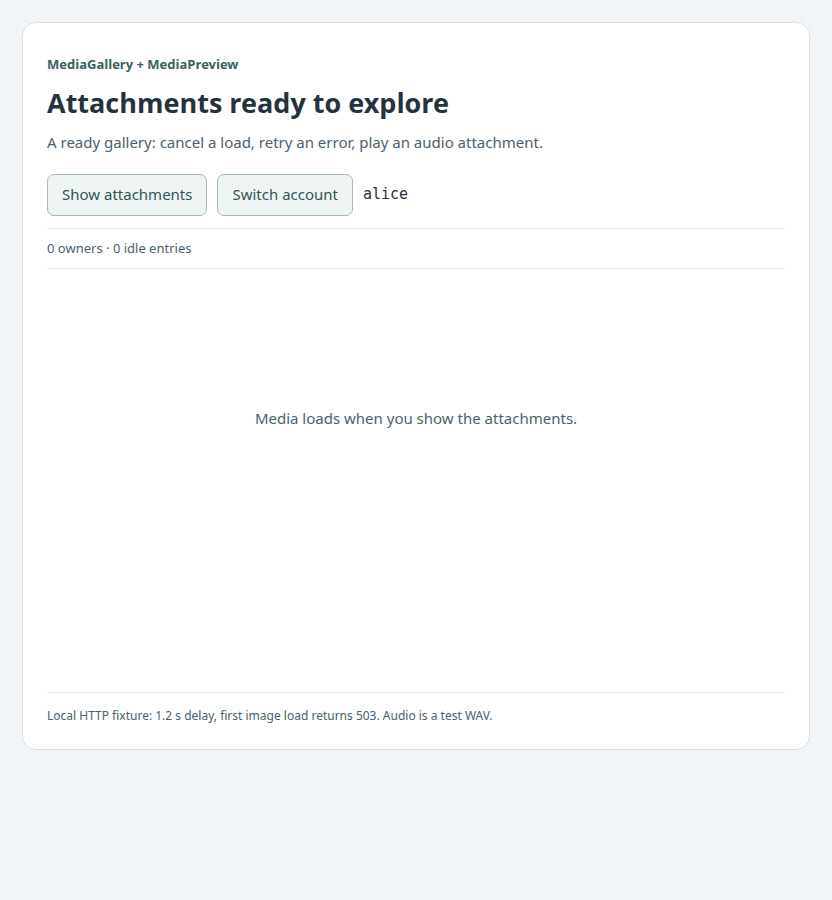

# A useful attachment gallery in your React application

[← README](../../README.md) · [Русский](application.ru.md) · [API reference](reference.en.md) · [Versions](../index.md)

An attachment view should show the file, explain why it is waiting, and let the user recover when loading fails. `MediaGallery` provides that starting point. It combines small `MediaPreview` cards, so a failed image or cancelled audio does not replace the whole collection with one error screen.

## Add the application pieces

Add the two package dependencies shown in the [README](../../README.md) alongside your existing React/React DOM. Publication is pending; the [local artifact instructions](en.md#local-installation) describe evaluation without a registry release. React 18.3+ remains the baseline; no React 19-only feature is required.

Use this small file layout:

```text
src/media/attachments.tsx   # copy the complete AttachmentGallery.tsx example
src/app.tsx                # provide the active account and stable cache
```

The [complete AttachmentGallery.tsx](../../examples/AttachmentGallery.tsx) includes imports, cache creation, business metadata, rendering and account cleanup. Create the cache once in the browser application entry; pass it to `AttachmentGallery` together with the active account. Do not create a cache during every render or share one server-side session instance across unrelated users.

```tsx
import { AttachmentGallery, createAttachmentMediaCache } from './media/attachments';

const cache = createAttachmentMediaCache();
export function App({ accountId }: { accountId: string }) {
  return <AttachmentGallery cache={cache} accountId={accountId} />;
}
```

The example's endpoint is `GET /api/accounts/:accountId/media/:mediaKey`. Your server must authorize that account and return a finite media response with a correct Content-Type. This route is an integration example, not a server implementation included in the npm package. Browser session cookies are used by the sample; substitute your application's authorized request callback or fetch transport when needed.

## Read the example from outside in

`createAttachmentMediaCache` delegates HTTP status checks, response byte limits, the deadline and Blob creation to the core factory. `previews` is the default profile: 8 MiB per HTTP response, 30 seconds for loading, 128 retained entries and a 64 MiB retained-byte target. [Profiles and overrides](https://github.com/dlorian59/browser-media-cache/blob/main/docs/0.1.0/application.en.md#choose-a-profile).

`AttachmentGallery` supplies a stable namespace through `MediaCacheProvider`. It maps the application's attachment descriptions to `MediaGalleryItem` values. Two items deliberately use the same image key; they have different IDs because they are different visible cards. `MediaGallery` creates a `MediaPreview` for each item and gives each one independent retry/cancellation controls.

The comments are EN first, RU immediately afterward. Keep the division of responsibility: application metadata and authorization outside; cache ownership and visual state inside the existing package components.

## One preview and its states

```tsx
import { MediaPreview } from '@59alex/browser-media-cache-react';

<MediaPreview mediaKey="photo:42:v3" alt="Project sketch" />;
<MediaPreview mediaKey="voice:19:v1" kind="audio" alt="Voice attachment" />;
<MediaPreview mediaKey="clip:8:v2" kind="video" alt="Short walkthrough" />;
```

Mount these inside the provider from the README. The full source also includes `AttachmentPreview`, a complete single-item component accepting the account, key, description and media kind. A preview uses `image` and English labels by default; `language="ru"` changes the built-in controls. `className` and `style` customize its outer surface. Native audio/video controls are enabled, `preload="metadata"`, no autoplay; the complete Blob has already been loaded before the native player receives its URL. Browser codecs and autoplay policies still apply. Removing a player pauses it and clears its element source; another owner may continue using the same cached Blob.

| What the user sees | What happens |
|---|---|
| No media selected | `mediaKey=null`; no acquisition. |
| Loading media… / Cancel | A handle owns the pending load. Cancel unmounts this owner; another owner's shared request continues. |
| Loading cancelled / Load again | This card has no active handle. The button mounts a new owner. |
| Media could not be loaded / Retry | Acquisition failed. Retry remounts only this consumer; the failed cache entry has been removed, so a new load can run. |
| Ready image/audio/video | The card owns the resource until removal, account/key replacement or explicit invalidation. |
| This media could not be displayed / Retry display | Native decoding failed after a successful load. Retrying display uses the same cached bytes; it does not invalidate another owner's resource. |

Do not repeatedly retry an unsupported codec. When a corrected file replaces damaged content, change its versioned identity:

```tsx
<MediaPreview mediaKey={`photo:${photo.id}:v${photo.revision}`} alt={photo.description} />;
```

This loads the corrected revision without revoking another view's old URL. Explicit cache invalidation is available when the application deliberately needs all owners to stop using a resource. It is not hidden inside a native decode-error button.

## Your data and shared downloads

```tsx
import { MediaGallery } from '@59alex/browser-media-cache-react';

<MediaGallery items={[
  { id: 'message-photo', mediaKey: 'photo:42:v3', alt: 'Project sketch', title: 'Message attachment' },
  { id: 'sidebar-photo', mediaKey: 'photo:42:v3', alt: 'Project sketch preview', title: 'Sidebar' },
]} />;
```

IDs must be unique and stable within the collection; media keys may repeat. Both cards above share one resource, but cancelling or removing one does not end the other's ownership. An empty array renders “No attachments”. Titles are optional. The default grid adapts to its container; `style` can override grid properties and `className` lets the host apply its own layout rules.

For a custom image presentation, keep using `CachedImage`. For download links or your own player, use `MediaBoundary`. For a fully custom status UI, use `useCachedMedia`. Their existing behavior is unchanged; [recordings and integration snippets](visuals.en.md) cover all four original runtime exports. The [full Gallery source](../../examples/Gallery.tsx) is the companion example for that level of control.

## Account lifetime

Provider scope changes immediately hide the previous account's resource. The ready preview's cancellation/error control state is reset for a new namespace/key. Unmount old account content, await `clearAttachmentAccount(cache, oldAccountId)` from the full example, then finish logout according to your session policy. Namespace replacement by itself does not delete persistent data.

```tsx
// EN: Hide the old account's content before awaiting cleanup.
// RU: Уберите содержимое старого аккаунта до ожидания очистки.
await clearAttachmentAccount(cache, oldAccountId);
```

The provider does not own cache lifetime: it never calls `dispose()`. The browser application owner disposes at shutdown. In development StrictMode, effects may mount and clean up more than once; ownership remains in the existing core hook. Pending requests cannot publish a previous account's URL into the new scope.

## Try the gallery

With adjacent core and React checkouts, run from the React repository:

```sh
npm run bootstrap
PORT=5182 npm run demo
```

Open `http://127.0.0.1:5182/starter?lang=en` (`lang=ru` for Russian). The source is a runnable component example served by the existing demo, not a documentation website. Its local HTTP fixture deliberately delays loads by 1.2 seconds and returns 503 for the first Alice image request. The WAV is a generated test tone, not a voice-processing example.

1. Show attachments and cancel the audio load while pending.
2. The two shared image previews fail. Retry both; one new HTTP load serves both cards.
3. Load the audio again and use the native play button.
4. Hide/show the gallery: retained media returns without another HTTP request.
5. Switch account: old URLs disappear immediately, then the new namespace loads.

<picture><source media="(prefers-reduced-motion: reduce)" srcset="visuals/gallery.en.png"></picture>

[Static frame](visuals/gallery.en.png) · [Full integration source](../../examples/AttachmentGallery.tsx) · [HTTP fixture source](https://github.com/dlorian59/browser-media-cache-react/blob/main/demo/media-fixture.mjs)

This same recording demonstrates **MediaGallery** (collection/layout and shared resource) and **MediaPreview** (each card's controls/player). It is recorded from their real exported implementations. No video codec or production authentication result is claimed by the audio/image fixture.

To repeat capture and its assertions, stop the manual server and run:

```sh
MEDIA_CAPTURE_SCENES=gallery npm run docs:capture
```

The script checks real HTTP retry counts, shared object URLs, cancellation, native audio progress, zero owners after hiding, cache reuse and immediate account replacement. Raw frames/results go to ignored `output/playwright/media-visuals/`; GIF/PNG go to this guide's `visuals/` directory. The image uses a PNG for reduced-motion preference, and a direct static link for other viewers. Earlier primitive recordings remain available via [the visual guide](visuals.en.md).

## Boundaries to keep visible

The factory bounds each HTTP download, not all browser memory. Active resources may exceed the cache's soft retained budget; decoded image/video memory, concurrent responses and persistence are separate. Use these components for finite attachments, not unbounded streams. A persistent hit bypasses HTTP download limits, so storage policy still matters. HTTP error text is intentionally generic in the ready UI; use the lower-level hook/reference when you need an application-specific explanation or telemetry.

[← README](../../README.md) · [API reference](reference.en.md) · [Original component visuals](visuals.en.md) · [Versions](../index.md)
