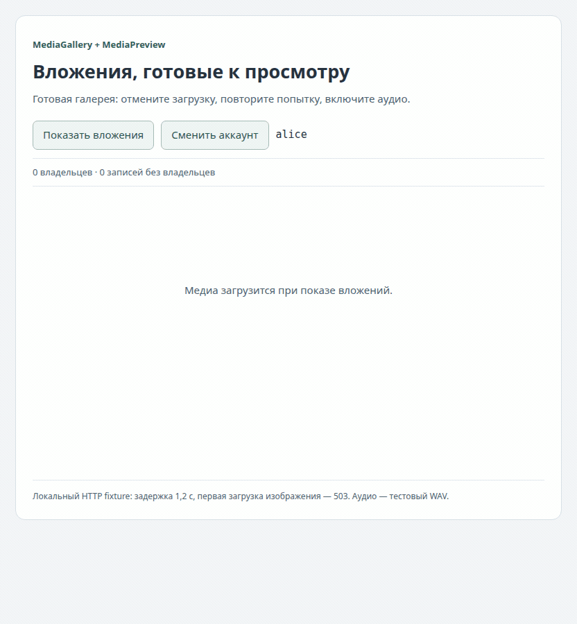

# Практичная галерея вложений в React-приложении

[← README](../../README.md) · [English](application.en.md) · [Справочник API](reference.ru.md) · [Версии](../index.md)

Представление вложения должно показывать файл, объяснять ожидание и позволять восстановиться после ошибки. `MediaGallery` даёт такую начальную конструкцию. Внутри — небольшие карточки `MediaPreview`, поэтому ошибка изображения или отмена аудио не заменяет всю коллекцию одним экраном ошибки.

## Подключение частей приложения

Добавьте две зависимости из [README](../../README.md) к существующим React/React DOM. Публикация пока не выполнена; [локальные артефакты](ru.md#локальная-установка) позволяют проверить интеграцию без registry release. Базовой остаётся React 18.3+; возможности только React 19 не требуются.

Достаточно такой структуры:

```text
src/media/attachments.tsx   # полный пример AttachmentGallery.tsx
src/app.tsx                # активный аккаунт и стабильный кэш
```

[Полный AttachmentGallery.tsx](../../examples/AttachmentGallery.tsx) содержит импорты, создание кэша, бизнес-метаданные, отображение и очистку аккаунта. Создайте кэш один раз в точке входа браузерного приложения; передайте его в `AttachmentGallery` вместе с активным аккаунтом. Не создавайте кэш заново при render и не разделяйте один экземпляр серверной сессии между посторонними пользователями.

```tsx
import { AttachmentGallery, createAttachmentMediaCache } from './media/attachments';

const cache = createAttachmentMediaCache();
export function App({ accountId }: { accountId: string }) {
  return <AttachmentGallery cache={cache} accountId={accountId} language="ru" />;
}
```

Endpoint примера: `GET /api/accounts/:accountId/media/:mediaKey`. Ваш сервер проверяет доступ к аккаунту и возвращает конечный медиа-ответ с правильным Content-Type. Это контракт примера, а не готовый сервер в npm-пакете. Пример использует cookies браузерной сессии; при необходимости передайте авторизованный request callback или fetch вашего приложения.

## Разбор примера от внешнего к внутреннему

`createAttachmentMediaCache` поручает фабрике ядра проверку HTTP, размера, дедлайна и сборку Blob. `previews` — профиль по умолчанию: 8 MiB на HTTP-ответ, 30 секунд на загрузку, 128 записей и целевой бюджет удерживаемых данных 64 MiB. [Профили и переопределения](https://github.com/dlorian59/browser-media-cache/blob/main/docs/0.1.0/application.ru.md#выбор-профиля).

`AttachmentGallery` передаёт стабильный namespace через `MediaCacheProvider`. Он отображает бизнес-описания вложений в `MediaGalleryItem`. Два элемента намеренно имеют один ключ изображения, но разные ID: это разные видимые карточки. `MediaGallery` создаёт для каждого элемента `MediaPreview` с независимыми отменой и повтором.

Комментарии идут EN, затем RU. Сохраняйте границу ответственности: метаданные и авторизация принадлежат приложению; владение кэшем и отображение состояния — существующим компонентам пакета.

## Одно превью и его состояния

```tsx
import { MediaPreview } from '@59alex/browser-media-cache-react';

<MediaPreview mediaKey="photo:42:v3" alt="Эскиз проекта" language="ru" />;
<MediaPreview mediaKey="voice:19:v1" kind="audio" alt="Голосовое вложение" language="ru" />;
<MediaPreview mediaKey="clip:8:v2" kind="video" alt="Короткая демонстрация" language="ru" />;
```

Разместите компоненты внутри provider из README. В полном исходнике также есть `AttachmentPreview`: готовый компонент одного вложения с аккаунтом, ключом, описанием и типом медиа. По умолчанию используются `image` и английские подписи; `language="ru"` переключает встроенные контролы. `className` и `style` меняют внешнюю поверхность. Аудио/видео используют нативные controls, `preload="metadata"`, без autoplay; к моменту передачи URL плееру Blob уже загружен целиком. Поддержка кодеков и политика воспроизведения остаются в браузере. При удалении плеер останавливается, его src очищается; другой владелец может продолжать использовать тот же Blob.

| Что видит пользователь | Что происходит |
|---|---|
| Медиа не выбрано | `mediaKey=null`; получения ресурса нет. |
| Загрузка медиа… / Отменить | Handle владеет ожидающей загрузкой. Отмена снимает этого владельца; общая загрузка другого продолжается. |
| Загрузка отменена / Загрузить снова | У карточки нет активного handle. Кнопка создаёт нового владельца. |
| Не удалось загрузить медиа / Повторить | Получение ресурса не удалось. Retry перемонтирует только этого потребителя; неудачная запись удалена из кэша, возможна новая загрузка. |
| Готовое изображение/аудио/видео | Карточка владеет ресурсом до удаления, смены аккаунта/ключа или явной инвалидации. |
| Не удалось отобразить медиа / Повторить отображение | Нативное декодирование завершилось ошибкой после успешной загрузки. Повтор использует те же байты и не инвалидирует ресурс другого владельца. |

Не повторяйте бесконечно неподдерживаемый кодек. Когда повреждённый файл исправлен, измените версию его ключа:

```tsx
<MediaPreview mediaKey={`photo:${photo.id}:v${photo.revision}`} alt={photo.description} language="ru" />;
```

Исправленная ревизия загрузится без отзыва старого URL у другого представления. Явная инвалидация доступна, когда приложение осознанно должно прекратить использование ресурса всеми владельцами. Она не скрыта за кнопкой ошибки декодирования.

## Ваши данные и общие загрузки

```tsx
import { MediaGallery } from '@59alex/browser-media-cache-react';

<MediaGallery items={[
  { id: 'message-photo', mediaKey: 'photo:42:v3', alt: 'Эскиз проекта', title: 'Вложение сообщения' },
  { id: 'sidebar-photo', mediaKey: 'photo:42:v3', alt: 'Превью эскиза', title: 'Боковая панель' },
]} language="ru" />;
```

ID должны быть уникальными и стабильными внутри коллекции; ключи медиа могут повторяться. Карточки разделяют один ресурс, но отмена или удаление одной не завершает владение другой. Пустой массив показывает «Вложений нет». Заголовки необязательны. Сетка подстраивается под контейнер; `style` переопределяет grid-параметры, `className` позволяет подключить стили приложения.

Для собственного изображения используйте `CachedImage`. Для скачивания и своих плееров — `MediaBoundary`. Для полностью собственного UI состояния — `useCachedMedia`. Их поведение сохранено; [записи и код интеграции](visuals.ru.md) покрывают все четыре исходных runtime-экспорта. [Полный Gallery](../../examples/Gallery.tsx) показывает этот уровень настройки.

## Время жизни аккаунта

При смене области provider ресурс прошлого аккаунта сразу скрывается. Состояние отмены/ошибки готового превью сбрасывается для нового namespace/key. Сначала уберите старый контент, дождитесь `clearAttachmentAccount(cache, oldAccountId)` из полного примера, затем завершите выход согласно политике сессии. Одна лишь замена namespace не удаляет постоянные данные.

```tsx
// EN: Hide the old account's content before awaiting cleanup.
// RU: Уберите содержимое старого аккаунта до ожидания очистки.
await clearAttachmentAccount(cache, oldAccountId);
```

Provider не владеет временем жизни кэша и не вызывает `dispose()`. При завершении работы это делает владелец браузерного приложения. В development StrictMode effects могут монтироваться и очищаться повторно; владением управляет прежний hook ядра. Ожидающая загрузка прошлого аккаунта не может опубликовать его URL в новую область.

## Попробовать галерею

Расположите checkout ядра и React рядом, из React-репозитория выполните:

```sh
npm run bootstrap
PORT=5182 npm run demo
```

Откройте `http://127.0.0.1:5182/starter?lang=ru` (`lang=en` — английский). Это запускаемый пример компонентов на существующем demo-сервере, а не сайт документации. Локальный HTTP-fixture задерживает ответы на 1,2 секунды и возвращает 503 на первую загрузку изображения Alice. WAV — сгенерированный тестовый тон, а не пример обработки речи.

1. Покажите вложения и отмените аудио во время ожидания.
2. Два общих превью изображения завершатся ошибкой. Повторите обе попытки: одна новая HTTP-загрузка обслужит обе карточки.
3. Загрузите аудио снова и нажмите нативную кнопку воспроизведения.
4. Скройте/покажите галерею: удерживаемые медиа вернутся без новых HTTP-запросов.
5. Смените аккаунт: старые URL сразу исчезнут, затем загрузится новый namespace.

<picture><source media="(prefers-reduced-motion: reduce)" srcset="visuals/gallery.ru.png"></picture>

[Статичный кадр](visuals/gallery.ru.png) · [Полный код интеграции](../../examples/AttachmentGallery.tsx) · [Исходник HTTP-fixture](https://github.com/dlorian59/browser-media-cache-react/blob/main/demo/media-fixture.mjs)

Одна запись демонстрирует **MediaGallery** (коллекция, раскладка, общий ресурс) и **MediaPreview** (контролы и плеер карточек). Записаны настоящие экспортируемые компоненты. Этот audio/image-fixture не доказывает поддержку видеокодеков или production-авторизацию.

Для повторения записи и проверок остановите ручной сервер и выполните:

```sh
MEDIA_CAPTURE_SCENES=gallery npm run docs:capture
```

Скрипт проверяет реальные HTTP-повторы, общие object URL, отмену, продвижение нативного аудио, ноль владельцев после скрытия, использование кэша и немедленную смену аккаунта. Кадры/результаты сохраняются в игнорируемом `output/playwright/media-visuals/`, GIF/PNG — в `visuals/` этого руководства. Для уменьшения движения используется PNG; для других просмотрщиков есть прямая ссылка на статичный кадр. Прежние записи примитивов доступны в [визуальном руководстве](visuals.ru.md).

## Границы применения

Фабрика ограничивает каждую HTTP-загрузку, а не всю память браузера. Активные ресурсы могут превышать мягкий бюджет кэша; декодированные изображения/видео, одновременные ответы и постоянное хранилище учитываются отдельно. Компоненты предназначены для конечных вложений, а не бесконечных потоков. Попадание в постоянный store обходит HTTP-лимиты, поэтому его политика важна отдельно. Готовый UI намеренно показывает общий текст ошибки HTTP; для прикладного объяснения или telemetry используйте нижний уровень hook/reference.

[← README](../../README.md) · [Справочник API](reference.ru.md) · [Исходные компоненты в действии](visuals.ru.md) · [Версии](../index.md)
