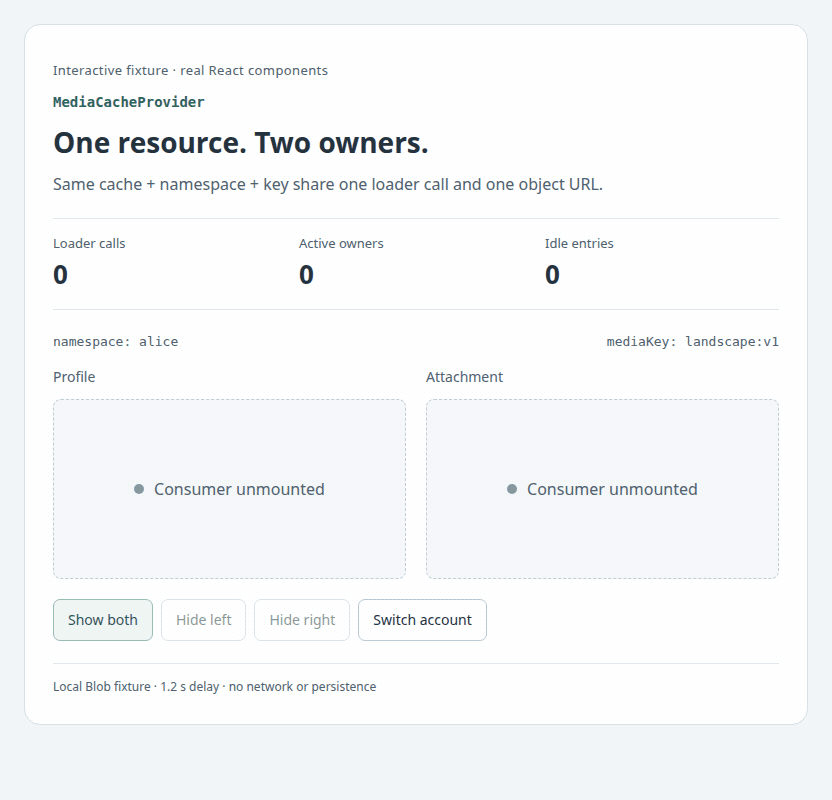
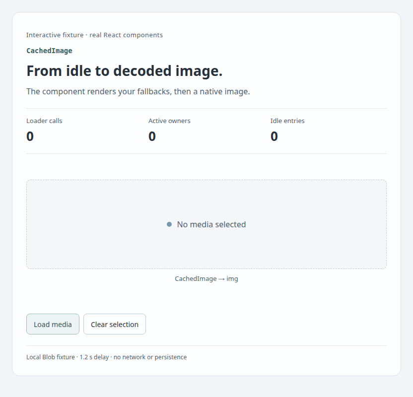
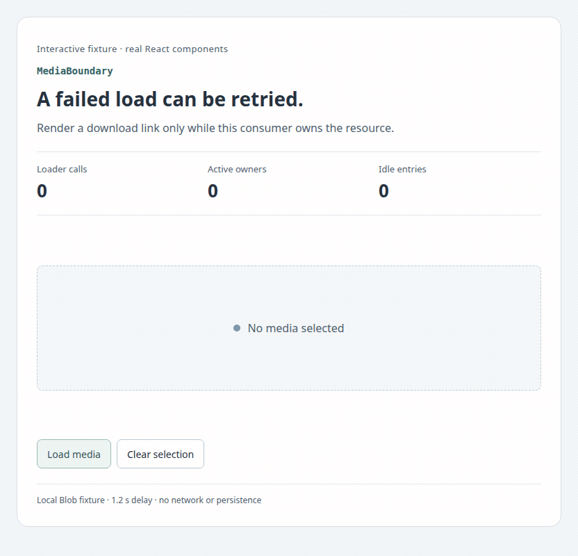
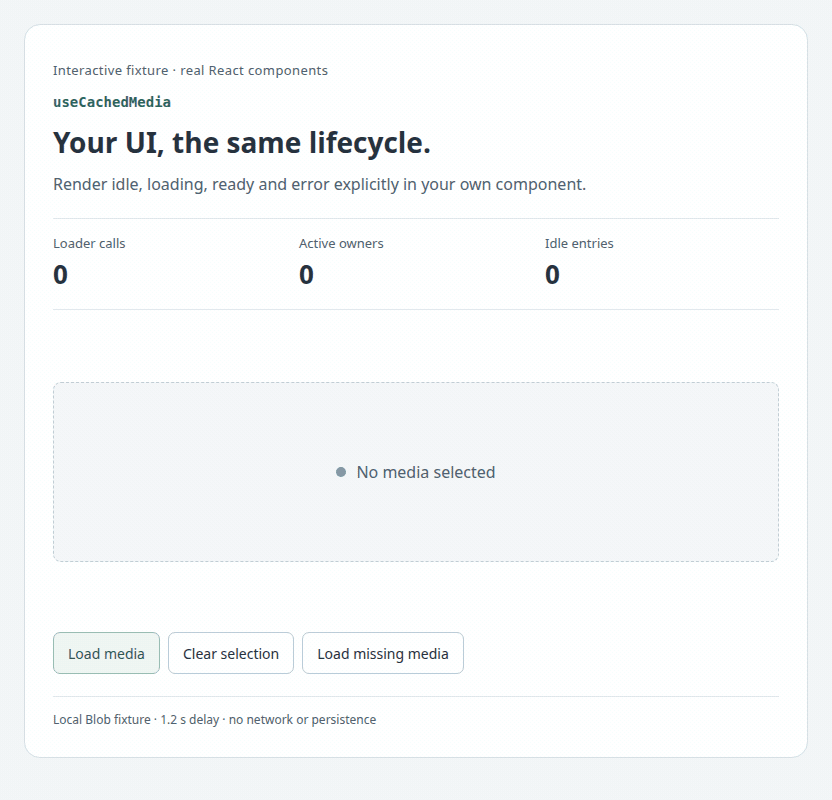

# React media components in motion · 0.1.0

[← Guide](en.md) · [RU](visuals.ru.md) · [API reference](reference.en.md) · [Versions](../index.md) · [README](../../README.md)

Four recordings show every runtime export from [src/index.tsx](https://github.com/dlorian59/browser-media-cache-react/blob/main/src/index.tsx). These are actual components running in Chromium, with local Blob fixtures and a deliberate 1.2-second loader delay. Counts come from `MediaCache.inspect()` and the fixture loader. They are observations of this example, not network benchmarks. No remote service, authentication or persistent storage is involved.

## Try the examples

Use Node 24 and adjacent `browser-media-cache` / `browser-media-cache-react` checkouts. From this repository:

```sh
npm run bootstrap
PORT=5182 npm run demo
```

Open `http://127.0.0.1:5182/visuals?scene=provider&lang=en`. Change `scene` to `image`, `boundary` or `hook`; `lang=ru` selects Russian. This is a runnable component example served by the existing demo server. Documentation stays in Markdown.

[Typed integration source](../../examples/VisualGuide.tsx) · [Local loader and cache owner](https://github.com/dlorian59/browser-media-cache-react/blob/main/demo/visuals.jsx) · [Styles and reduced motion](https://github.com/dlorian59/browser-media-cache-react/blob/main/demo/visuals.html)

For production loading, use [create-cache.ts](../../examples/create-cache.ts): create a stable cache once, fetch authenticated media with the supplied abort signal, and mount the provider around consumers. All snippets below assume this caller-owned `cache`. The fixture instead creates small SVG/text Blobs, retains idle entries for 60 seconds and fails the first notes request intentionally.

| Export | Recording | Observable behavior |
|---|---|---|
| `MediaCacheProvider` | [Shared children](#mediacacheprovider) | Two consumers, one URL/load; release one owner; reuse idle entry; switch namespace |
| `CachedImage` | [Image states](#cachedimage) | Disabled → loading → decoded native image; clear and reuse |
| `MediaBoundary` | [Explicit retry](#mediaboundary) | Idle → loading → error → user retry → usable download |
| `useCachedMedia` | [Custom UI](#usecachedmedia) | Render idle/loading/ready/error; Blob metadata; restore cached image |

## MediaCacheProvider

[Runnable source: VisualGuide provider branch](../../examples/VisualGuide.tsx) · [Scope contract](reference.en.md#provider-and-hook)

```tsx
import { MediaCacheProvider, CachedImage } from '@59alex/browser-media-cache-react';

// EN: Both children share a stable cache, namespace and logical media key.
// RU: Оба потомка используют стабильный cache, namespace и логический ключ медиа.
<MediaCacheProvider cache={cache} namespace="alice">
  <CachedImage mediaKey="landscape:v1" alt="Profile preview" width={300} height={180}
    loadingFallback={<span role="status">Loading profile…</span>} />
  <CachedImage mediaKey="landscape:v1" alt="Attachment preview" width={300} height={180}
    loadingFallback={<span role="status">Loading attachment…</span>} />
</MediaCacheProvider>;
```

<picture><source media="(prefers-reduced-motion: reduce)" srcset="visuals/provider.en.png"></picture>

[Static frame](visuals/provider.en.png) · [GIF](visuals/provider.en.gif)

Press **Show both**, **Hide left**, **Hide right**, then **Show both**. Loader calls stay at **1**, owners go **2 → 1 → 0 → 2**, and the idle entry returns to active use with the same object URL. **Switch account** changes `alice` to `bob` and causes a second loader call. The old account's idle entry remains until eviction or explicit invalidation: switching namespace is not logout cleanup. Provider unmount releases its children; the application still owns the cache and must dispose it at shutdown.

## CachedImage

[Runnable source: VisualGuide image branch](../../examples/VisualGuide.tsx) · [Native ref and event example](../../examples/ImageStates.tsx) · [Image contract](reference.en.md#cachedimage)

```tsx
import { CachedImage } from '@59alex/browser-media-cache-react';

// EN: Set mediaKey to null to disable acquisition; supply fallbacks with reserved space.
// RU: Передайте null для отключения загрузки; заранее выделите место под заглушки.
<CachedImage mediaKey={mediaKey} alt="Attachment preview" width={480} height={240}
  idleFallback={<span>No media selected</span>}
  loadingFallback={<span role="status">Loading media…</span>}
  errorFallback={<span role="status">Media unavailable</span>}
  onLoad={() => setDecoded(true)} />;
```

<picture><source media="(prefers-reduced-motion: reduce)" srcset="visuals/image.en.png"></picture>

[Static frame](visuals/image.en.png) · [GIF](visuals/image.en.gif)

In the source, `mediaKey` and `decoded` are local `useState` values; **Load media** selects `landscape:v1`, **Clear selection** sets it to `null`. The decoded label comes from the native `img.onLoad`, not the loader promise. Error fallback covers acquisition errors; a native image decode failure goes to `onError` instead. Width/height style only the ready image, so the example reserves fallback space separately. Reuse is immediate here; idle retention and memory pressure can change that in an application.

## MediaBoundary

[Runnable source: VisualGuide boundary branch](../../examples/VisualGuide.tsx) · [Boundary contract](reference.en.md#mediaboundary)

```tsx
import { useState } from 'react';
import { MediaBoundary } from '@59alex/browser-media-cache-react';

function Notes() {
  const [attempt, setAttempt] = useState(0);
  return <MediaBoundary key={attempt} mediaKey="notes:v1"
    loadingFallback={<span role="status">Loading notes…</span>}
    errorFallback={() => <button onClick={() => setAttempt(n => n + 1)}>Retry load</button>}>
    {/* EN: Keep the link within the owner's lifetime; retry remounts only this consumer. */}
    {/* RU: Ссылка живёт вместе с владельцем; повтор перемонтирует только этого потребителя. */}
    {resource => <a href={resource.url} download="notes.txt">Download notes</a>}
  </MediaBoundary>;
}
```

<picture><source media="(prefers-reduced-motion: reduce)" srcset="visuals/boundary.en.png"></picture>

[Static frame](visuals/boundary.en.png) · [GIF](visuals/boundary.en.gif)

The recording starts disabled (`mediaKey=null`) so you can see all four states. **Load media** selects notes; the fixture rejects once; **Retry load** increments the React key. This remount makes a fresh acquisition for the same logical media identity. It does not invalidate other owners and does not implement automatic retries/backoff. The recorder fetches the final Blob URL and asserts its exact text. `MediaBoundary` handles resource states, not exceptions thrown by arbitrary descendant rendering; it is not a React Error Boundary.

## useCachedMedia

[Runnable source: HookPreview](../../examples/VisualGuide.tsx) · [Hook and state contract](reference.en.md#provider-and-hook)

```tsx
import { useCachedMedia } from '@59alex/browser-media-cache-react';

function Preview({ mediaKey }: { mediaKey: string | null }) {
  const state = useCachedMedia(mediaKey);
  // EN: Narrow the state before using a resource; keep URL use inside this owner.
  // RU: Сначала сузьте состояние; используйте URL только внутри владельца ресурса.
  switch (state.status) {
    case 'idle': return <p>No media selected</p>;
    case 'loading': return <p role="status">Loading…</p>;
    case 'error': return <p role="status">Media unavailable</p>;
    case 'ready': return <figure>
      
      <figcaption>{state.resource.blob.size} bytes</figcaption>
    </figure>;
  }
}
```

<picture><source media="(prefers-reduced-motion: reduce)" srcset="visuals/hook.en.png"></picture>

[Static frame](visuals/hook.en.png) · [GIF](visuals/hook.en.gif)

Mount `Preview` inside `MediaCacheProvider`. **Load media** displays a resource plus MIME type/size, **Load missing media** changes the key to a fixture failure, and **Clear selection** returns to idle. Selecting the original key reuses its retained Blob. The hook provides no visual markup: all displayed UI belongs to the example. Do not save `resource.url` for use after unmount or invalidation. A missing provider throws during render, rather than returning an error state.

## Exported types

| Type | Where it is demonstrated |
|---|---|
| `MediaCacheProviderProps` | Provider `cache`, `namespace`, `children` above |
| `CachedImageProps` | Image `mediaKey`, required `alt`, fallbacks and native `onLoad` above |
| `MediaBoundaryProps` | Boundary render function and fallback props above |
| `MediaState` | Hook's discriminated `status` branches above |
| `MediaResource` | Boundary/hook access to `url` and `blob` above |

These are compile-time contracts, not additional visual components. See [all props/defaults/limits](reference.en.md) and the [public declarations source](https://github.com/dlorian59/browser-media-cache-react/blob/main/src/index.tsx).

## Reproduce the recordings

After bootstrap, install Chromium for the local Playwright version if it is not available (`npx playwright install chromium`), and ensure `ffmpeg` is on PATH. Stop the manual demo first: capture starts and stops its own loopback server on port 5182.

```sh
npm run docs:capture
```

[Capture script](https://github.com/dlorian59/browser-media-cache-react/blob/main/scripts/capture-visuals.mjs) records both languages at 832 × 800, samples real browser frames and encodes GIFs at 8 fps. It checks loaded image dimensions, shared URL equality, loader/owner counts, idle reuse, namespace replacement, retry content and absence of browser errors. PNGs capture ready states; browsers honoring reduced motion select PNG automatically, with explicit static links for other viewers. Interactive loading indicators also respect reduced motion.

Generated assets: `docs/0.1.0/visuals/`. Raw frames and assertion results: `output/playwright/media-visuals/` (ignored). Set `MEDIA_VISUAL_PORT` if 5182 is busy; set `BROWSER_EXECUTABLE_CHROMIUM` to an existing compatible Chromium executable. A GIF above 2 MB fails capture. Existing broader lifecycle checks remain available with `npm run test:browser`.

**Troubleshooting:** missing core peer → run bootstrap with the adjacent core checkout; missing browser → install Chromium or select its executable; `EADDRINUSE` → stop the manual demo or change the capture port; missing ffmpeg → install it before recording. The PNG/GIF files are checked in, so reading the guide needs none of these tools.

[← Guide](en.md) · [API reference](reference.en.md) · [Documentation index](../index.md) · [README](../../README.md)
