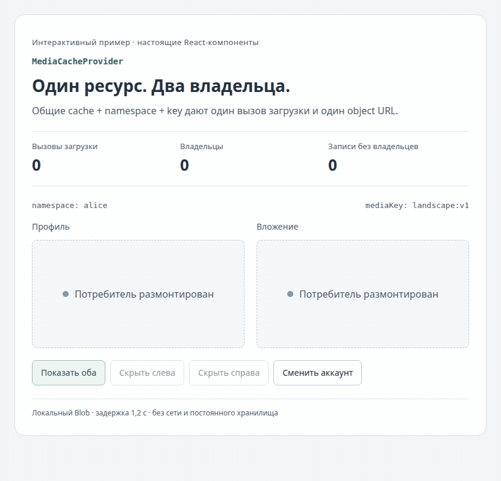
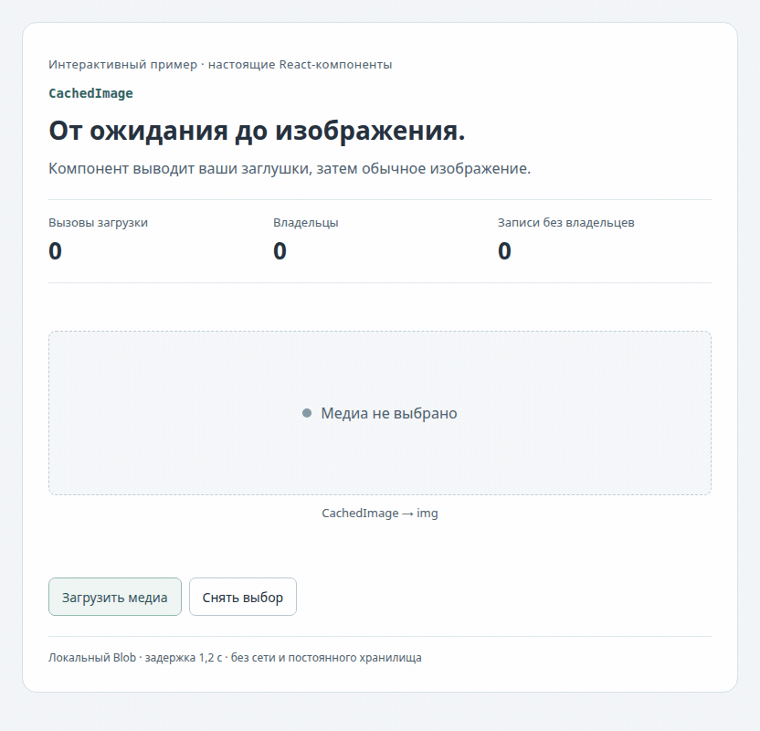
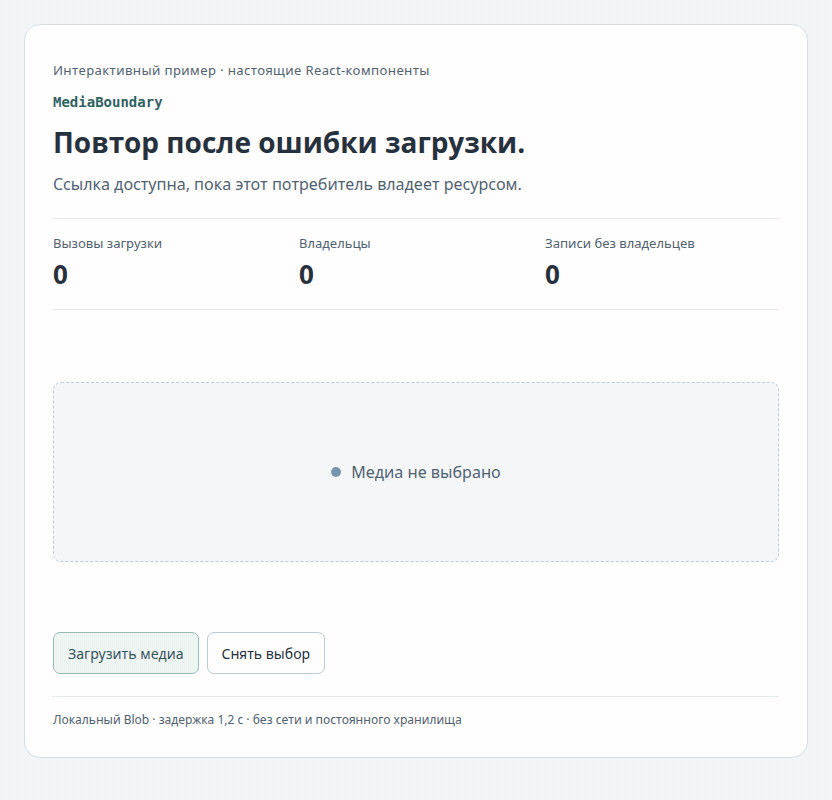
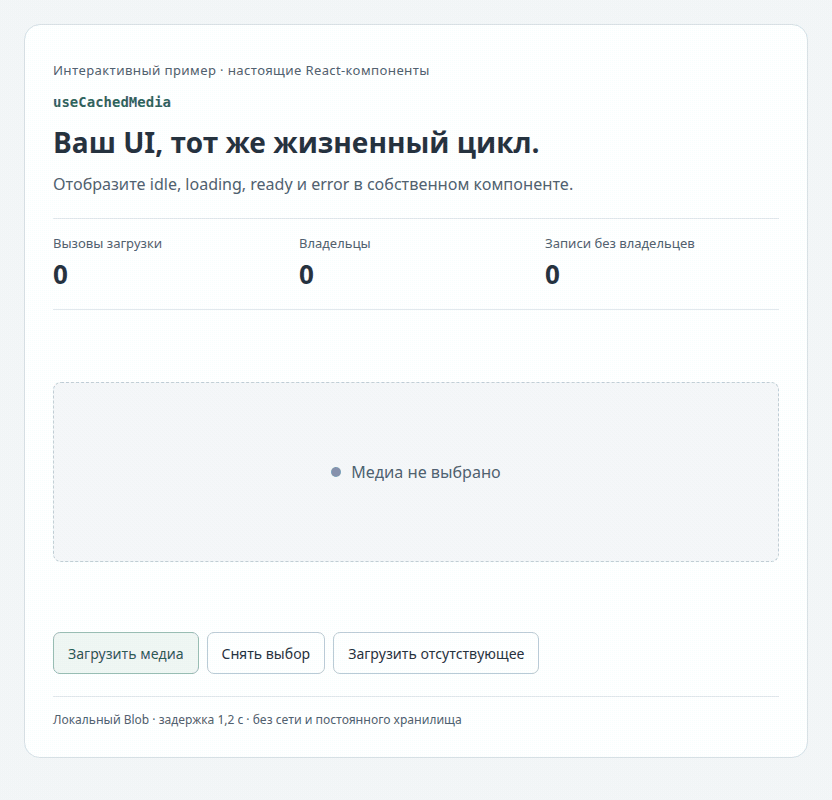

# React-компоненты медиа в действии · 0.1.0

[← Руководство](ru.md) · [EN](visuals.en.md) · [Справочник API](reference.ru.md) · [Версии](../index.md) · [README](../../README.md)

Четыре записи показывают четыре исходных runtime-экспорта из [src/index.tsx](https://github.com/dlorian59/browser-media-cache-react/blob/main/src/index.tsx). Это настоящие компоненты в Chromium с локальными Blob и намеренной задержкой загрузчика 1,2 секунды. Счётчики читают `MediaCache.inspect()` и число вызовов тестового загрузчика. Это наблюдения за примером, а не сетевой бенчмарк. Удалённого сервиса, аутентификации и постоянного хранилища здесь нет.

[Готовые MediaGallery + MediaPreview: интеграция, общая запись и исходник](application.ru.md).

## Запустить примеры

Нужны Node 24 и соседние checkout `browser-media-cache` / `browser-media-cache-react`. В этом репозитории выполните:

```sh
npm run bootstrap
PORT=5182 npm run demo
```

Откройте `http://127.0.0.1:5182/visuals?scene=provider&lang=ru`. Другие значения `scene`: `image`, `boundary`, `hook`; `lang=en` включает английский. Это запускаемый пример компонентов в существующем demo-сервере. Документация остаётся в Markdown.

[Типизированный код интеграции](../../examples/VisualGuide.tsx) · [Локальный загрузчик и владелец кэша](https://github.com/dlorian59/browser-media-cache-react/blob/main/demo/visuals.jsx) · [Стили и уменьшение движения](https://github.com/dlorian59/browser-media-cache-react/blob/main/demo/visuals.html)

Для загрузки в приложении используйте [create-cache.ts](../../examples/create-cache.ts): создайте стабильный кэш один раз, загрузите медиа с аутентификацией и переданным abort signal, разместите потребителей внутри provider. Во всех фрагментах ниже `cache` принадлежит приложению. Тестовый загрузчик вместо HTTP создаёт маленькие SVG/text Blob, удерживает неактивные записи 60 секунд и намеренно отклоняет первую загрузку заметок.

| Экспорт | Запись | Наблюдаемое поведение |
|---|---|---|
| `MediaCacheProvider` | [Общие ресурсы потомков](#mediacacheprovider) | Два потребителя, один URL/вызов загрузки; освобождение владельца; повторное использование; смена namespace |
| `CachedImage` | [Состояния изображения](#cachedimage) | Отключено → загрузка → декодированное изображение; снятие выбора и повторный показ |
| `MediaBoundary` | [Явный повтор](#mediaboundary) | Idle → loading → error → повтор пользователем → ссылка скачивания |
| `useCachedMedia` | [Собственный UI](#usecachedmedia) | Отображение idle/loading/ready/error; метаданные Blob; возврат к изображению из кэша |

## MediaCacheProvider

[Запускаемый код: ветка provider в VisualGuide](../../examples/VisualGuide.tsx) · [Контракт области](reference.ru.md#provider-и-hook)

```tsx
import { MediaCacheProvider, CachedImage } from '@59alex/browser-media-cache-react';

// EN: Both children share a stable cache, namespace and logical media key.
// RU: Оба потомка используют стабильный cache, namespace и логический ключ медиа.
<MediaCacheProvider cache={cache} namespace="alice">
  <CachedImage mediaKey="landscape:v1" alt="Превью профиля" width={300} height={180}
    loadingFallback={<span role="status">Загрузка профиля…</span>} />
  <CachedImage mediaKey="landscape:v1" alt="Превью вложения" width={300} height={180}
    loadingFallback={<span role="status">Загрузка вложения…</span>} />
</MediaCacheProvider>;
```

<picture><source media="(prefers-reduced-motion: reduce)" srcset="visuals/provider.ru.png"></picture>

[Статичный кадр](visuals/provider.ru.png) · [GIF](visuals/provider.ru.gif)

Нажмите **Показать оба**, **Скрыть слева**, **Скрыть справа**, затем **Показать оба**. Вызовов загрузки остаётся **1**, владельцев — **2 → 1 → 0 → 2**; неактивная запись снова используется с тем же object URL. **Сменить аккаунт** переключает `alice` на `bob` и вызывает вторую загрузку. Неактивная запись прошлого аккаунта остаётся до вытеснения или явной инвалидации: смена namespace не выполняет очистку при выходе. При размонтировании provider потомки освобождают ресурсы, но кэш по-прежнему принадлежит приложению; оно вызывает dispose при завершении работы.

## CachedImage

[Запускаемый код: ветка image в VisualGuide](../../examples/VisualGuide.tsx) · [Пример ref и событий](../../examples/ImageStates.tsx) · [Контракт изображения](reference.ru.md#cachedimage)

```tsx
import { CachedImage } from '@59alex/browser-media-cache-react';

// EN: Set mediaKey to null to disable acquisition; supply fallbacks with reserved space.
// RU: Передайте null для отключения загрузки; заранее выделите место под заглушки.
<CachedImage mediaKey={mediaKey} alt="Превью вложения" width={480} height={240}
  idleFallback={<span>Медиа не выбрано</span>}
  loadingFallback={<span role="status">Загрузка медиа…</span>}
  errorFallback={<span role="status">Медиа недоступно</span>}
  onLoad={() => setDecoded(true)} />;
```

<picture><source media="(prefers-reduced-motion: reduce)" srcset="visuals/image.ru.png"></picture>

[Статичный кадр](visuals/image.ru.png) · [GIF](visuals/image.ru.gif)

В исходнике `mediaKey` и `decoded` — локальные значения `useState`. **Загрузить медиа** выбирает `landscape:v1`, **Снять выбор** устанавливает `null`. Подпись о декодировании появляется из нативного `img.onLoad`, а не из Promise загрузчика. Error fallback обрабатывает ошибки получения ресурса; ошибка декодирования приходит отдельно в `onError`. Width/height применяются только к готовому изображению, поэтому пример отдельно резервирует место под заглушки. Здесь повторный показ быстрый; в приложении результат зависит от удержания неактивных записей и ограничения памяти.

## MediaBoundary

[Запускаемый код: ветка boundary в VisualGuide](../../examples/VisualGuide.tsx) · [Контракт boundary](reference.ru.md#mediaboundary)

```tsx
import { useState } from 'react';
import { MediaBoundary } from '@59alex/browser-media-cache-react';

function Notes() {
  const [attempt, setAttempt] = useState(0);
  return <MediaBoundary key={attempt} mediaKey="notes:v1"
    loadingFallback={<span role="status">Загрузка заметок…</span>}
    errorFallback={() => <button onClick={() => setAttempt(n => n + 1)}>Повторить загрузку</button>}>
    {/* EN: Keep the link within the owner's lifetime; retry remounts only this consumer. */}
    {/* RU: Ссылка живёт вместе с владельцем; повтор перемонтирует только этого потребителя. */}
    {resource => <a href={resource.url} download="notes.txt">Скачать заметки</a>}
  </MediaBoundary>;
}
```

<picture><source media="(prefers-reduced-motion: reduce)" srcset="visuals/boundary.ru.png"></picture>

[Статичный кадр](visuals/boundary.ru.png) · [GIF](visuals/boundary.ru.gif)

Запись начинается с `mediaKey=null`, чтобы показать все четыре состояния. **Загрузить медиа** выбирает заметки; тестовый загрузчик один раз возвращает ошибку; **Повторить загрузку** увеличивает React key. Размонтирование и новый mount повторяют получение того же логического медиа. Это не инвалидирует других владельцев и не добавляет автоматические повторы/backoff. Скрипт записи читает итоговый Blob URL и проверяет точное содержимое текста. `MediaBoundary` отображает состояния ресурса и не перехватывает произвольные ошибки render потомков; это не React Error Boundary.

## useCachedMedia

[Запускаемый код: HookPreview](../../examples/VisualGuide.tsx) · [Контракт hook и состояния](reference.ru.md#provider-и-hook)

```tsx
import { useCachedMedia } from '@59alex/browser-media-cache-react';

function Preview({ mediaKey }: { mediaKey: string | null }) {
  const state = useCachedMedia(mediaKey);
  // EN: Narrow the state before using a resource; keep URL use inside this owner.
  // RU: Сначала сузьте состояние; используйте URL только внутри владельца ресурса.
  switch (state.status) {
    case 'idle': return <p>Медиа не выбрано</p>;
    case 'loading': return <p role="status">Загрузка…</p>;
    case 'error': return <p role="status">Медиа недоступно</p>;
    case 'ready': return <figure>
      
      <figcaption>{state.resource.blob.size} байт</figcaption>
    </figure>;
  }
}
```

<picture><source media="(prefers-reduced-motion: reduce)" srcset="visuals/hook.ru.png"></picture>

[Статичный кадр](visuals/hook.ru.png) · [GIF](visuals/hook.ru.gif)

Разместите `Preview` внутри `MediaCacheProvider`. **Загрузить медиа** показывает ресурс, MIME-тип и размер; **Загрузить отсутствующее** меняет ключ на тестовую ошибку; **Снять выбор** возвращает idle. Возврат к исходному ключу использует сохранённый Blob. Hook не создаёт разметку: весь интерфейс принадлежит примеру. Не сохраняйте `resource.url` для использования после размонтирования или инвалидации. Отсутствие provider вызывает исключение во время render, а не возвращает состояние error.

## Экспортируемые типы

| Тип | Где показан |
|---|---|
| `MediaCacheProviderProps` | `cache`, `namespace`, `children` в примере provider выше |
| `CachedImageProps` | `mediaKey`, обязательный `alt`, заглушки и нативный `onLoad` в примере изображения |
| `MediaBoundaryProps` | Render-функция и fallback props в примере boundary |
| `MediaState` | Ветвление по дискриминатору `status` в примере hook |
| `MediaResource` | Доступ к `url` и `blob` в boundary/hook |

Это контракты типов, а не дополнительные визуальные компоненты. [Все props, defaults и ограничения](reference.ru.md) · [Исходник публичных объявлений](https://github.com/dlorian59/browser-media-cache-react/blob/main/src/index.tsx).

## Повторить запись

После bootstrap установите Chromium для локальной версии Playwright, если его ещё нет (`npx playwright install chromium`); `ffmpeg` должен быть доступен в PATH. Сначала остановите ручной demo: запись сама запускает и завершает сервер на loopback-порту 5182.

```sh
npm run docs:capture
```

[Скрипт записи](https://github.com/dlorian59/browser-media-cache-react/blob/main/scripts/capture-visuals.mjs) записывает оба языка в 832 × 800, снимает настоящие кадры браузера и кодирует GIF с частотой 8 кадров/с. Он проверяет размер загруженных изображений, одинаковый URL у владельцев, число загрузок и владельцев, повторное использование, смену namespace, содержимое после retry и отсутствие ошибок браузера. PNG показывает готовое состояние; при поддержке reduced motion браузер выбирает PNG автоматически. Для остальных просмотрщиков есть явные ссылки на статичные кадры. Индикатор загрузки в интерактивном примере тоже учитывает уменьшение движения.

Готовые файлы: `docs/0.1.0/visuals/`. Исходные кадры и результаты проверок: `output/playwright/media-visuals/` (игнорируются Git). Если 5182 занят, задайте `MEDIA_VISUAL_PORT`; для уже установленного совместимого Chromium задайте `BROWSER_EXECUTABLE_CHROMIUM`. GIF больше 2 MB прерывает проверку. Более широкие проверки жизненного цикла доступны через `npm run test:browser`.

**Устранение проблем:** отсутствует core peer → выполните bootstrap с соседним checkout ядра; нет браузера → установите Chromium или укажите путь к нему; `EADDRINUSE` → остановите ручной demo или измените порт записи; нет ffmpeg → установите его перед записью. PNG/GIF сохранены в репозитории, для чтения руководства эти инструменты не нужны.

[← Руководство](ru.md) · [Справочник API](reference.ru.md) · [Все версии](../index.md) · [README](../../README.md)
